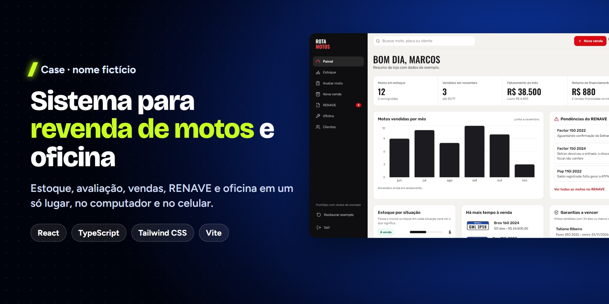
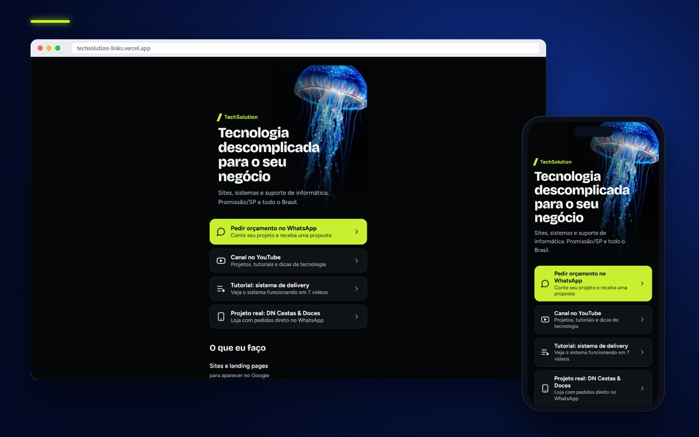

  

  
  
  
  
  

## Oi, eu sou o Danilo

Sou desenvolvedor web e fundador da **TechSolution**, em Promissão/SP. Transformo a rotina de pequenos e médios negócios em **sites, sistemas e aplicativos sob medida**: menos papel, menos planilha e mais tempo para vender.

Atendo Promissão e região pessoalmente e faço sites e sistemas para todo o Brasil.

> **Quer acompanhar os bastidores dos projetos?** [Siga **@__techsolution__** no Instagram](https://www.instagram.com/__techsolution__) e veja como cada sistema nasce, da conversa com o cliente até a entrega.

## O que eu faço

| | |
|---|---|
| **Sites e landing pages** | Rápidos, bonitos no celular, fáceis de achar no Google e com botão direto para o WhatsApp. |
| **Sistemas sob medida** | Delivery com pedidos sem comissão, agendamento, gestão de estoque e vendas, controle de oficina e o que o seu negócio precisar. |
| **Aplicativos** | Apps para empresas e instituições, com a identidade de cada cliente. |
| **Suporte de TI** | Formatação, upgrade de notebooks (SSD e memória) e configuração de computadores. |

## Projetos em destaque

<table>
  <tr>
    <td width="50%" valign="top">
      
      <h3><a href="https://github.com/dan1723/case-rota-motos">Sistema para revenda de motos e oficina</a></h3>
      Estoque, avaliação, vendas, RENAVE e oficina em um só lugar. Case com nome fictício e <a href="https://dan1723.github.io/case-rota-motos/demo/">demonstração online</a>.
        <code>React</code> <code>TypeScript</code> <code>Tailwind</code>
    </td>
    <td width="50%" valign="top">
      
      <h3><a href="https://github.com/dan1723/techsolution-links">Página de links da TechSolution</a></h3>
      A página da bio do Instagram, feita do zero, sem Linktree: rápida, leve e com a identidade da marca. <a href="https://techsolution-links.vercel.app">Ver no ar</a>.
        <code>HTML</code> <code>CSS</code> <code>Vercel</code>
    </td>
  </tr>
  <tr>
    <td width="50%" valign="top">
      <h3><a href="https://github.com/dan1723/Sistema-de-Vendas-Web">Sistema de Vendas Web</a></h3>
      Gestão de departamentos, vendedores e vendas, com relatórios de desempenho (totais, somas e médias).
        <code>C#</code> <code>ASP.NET Core MVC</code> <code>Entity Framework</code>
    </td>
    <td width="50%" valign="top">
      <h3>Delivery próprio para confeitaria</h3>
      Cardápio online, pedidos sem comissão e painel com aviso sonoro de pedido novo. Case completo em breve.
        <code>JavaScript</code> <code>Node.js</code> <code>Supabase</code>
    </td>
  </tr>
</table>

## Tecnologias que uso no dia a dia

  
  
  
  
  
  
  
  
  
  
  
  
  
  

## Formação

- **Tecnólogo em Análise e Desenvolvimento de Sistemas**, Fatec Lins (2025)
- **Bacharel em Administração de Empresas**, Anhanguera Uniderp (2016)

A formação em administração me ajuda a entender o negócio do cliente antes de escrever a primeira linha de código.

---

  <b>Tem um negócio e quer sair do caderno e da planilha?</b> 
  <a href="https://wa.me/5514991556986">Me chama no WhatsApp</a> e <a href="https://www.instagram.com/__techsolution__"><b>siga @__techsolution__ no Instagram</b></a> para conhecer o meu trabalho.

